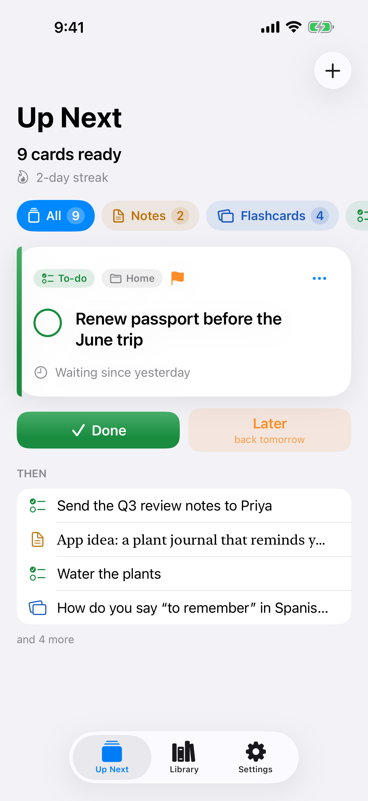
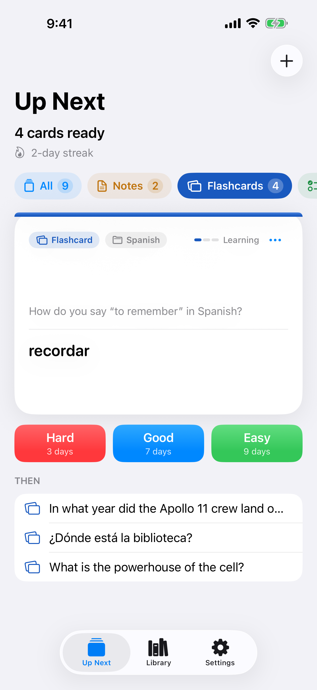
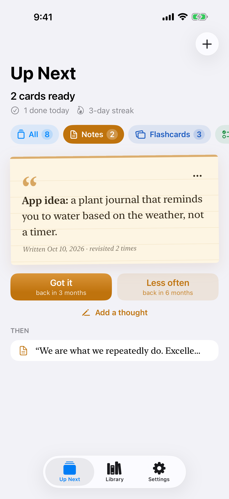
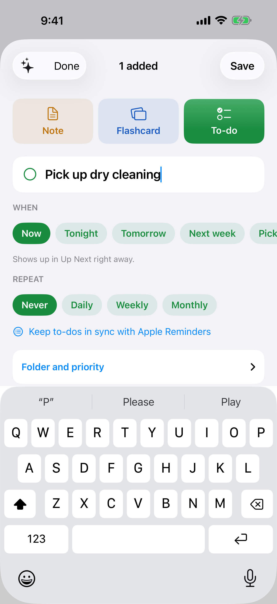
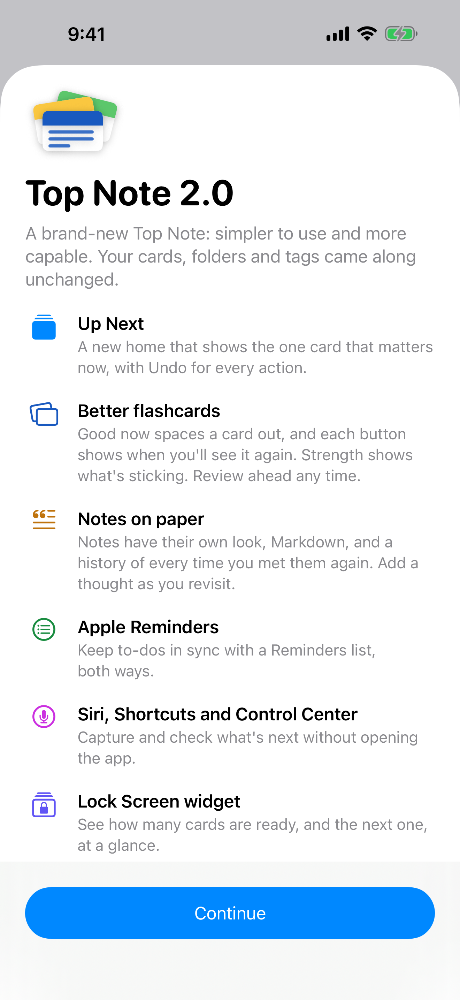

# Top Note

## Top Note 2.0 (November 2026)

**One thing at a time.** Top Note shows the one note, flashcard or to-do that matters right now: in the app, on your Home Screen and Lock Screen, and with Siri.

<p align="center">
  
  
  
  
  
</p>

How to use it (recorded from the UI tests): [flip and rate flashcards](<Marketing/HowTo/flashcards-flip-and-rate.gif>) · [revisit a note](<Marketing/HowTo/notes-revisit.gif>) · [capture anything](<Marketing/HowTo/capture-anything.gif>) · [full tour](<Marketing/HowTo/top-note-2-tour.gif>).

- **Up Next** (new home): the card that matters now, what's behind it, today's progress and streak, type filters, Undo for every action.
- **Flashcards** follow Recallable's scheduling: start 3 days out, Hard shrinks the interval, Good (×1.15) and Easy (×1.5) grow it, and each button previews when the card returns. Strength (New/Learning/Familiar/Strong) and review-ahead. 1.x cards adopt Good-grows once at launch (`LibraryMaintenance`).
- **Notes** are paper and serif, support Markdown, show their revisit history, and take a dated "Add a thought". Got it = back on schedule; Less often = at least 2× later.
- **To-dos** pick When/Repeat and sync both ways with an Apple Reminders list (`TopNote/Reminders/RemindersSync.swift`): the reminder's URL is `topnote://card/<id>`, plus a per-device three-way baseline. No SwiftData/CloudKit schema change.
- **App Intents**: Add Note/To-do/Flashcard (background), What's Next (snippet), Cards Ready, Study Flashcards, Rate Flashcard, Complete/Skip, Open Capture/Up Next; seven Siri phrases; two Control Center controls; a Lock Screen "Ready Now" widget.
- **Launch splash, onboarding (with an example set), What's New for upgraders, and TipKit** as one ordered group with daily frequency (`TopNote/Tips/Tips.swift`).
- **Fixes**: widget reloads used the wrong kind; store failures now move the library aside to `Recovery/<date>/` in the App Group instead of deleting it; the 1.x compile error in `CardOptionsSection`; missing `.localized` helper.

Validation and release status: [docs/RELEASE_2_0.md](docs/RELEASE_2_0.md). Listing text and screenshots: `Marketing/AppStore/`.

### Develop

Open `TopNote.xcodeproj`, scheme **TopNote** (iOS 18+). Tests: `xcodebuild test -scheme TopNote -only-testing:UnitTests` (the Reminders suite needs Reminders access for the host app; on a simulator run `xcrun simctl privacy <udid> grant reminders zacharysturman.TopNote`). UI flows and App Store screenshots: `-only-testing:UITests/AppStoreScreenshotTests`, with `TEST_RUNNER_TOPNOTE_SCREENSHOT_DIR=<folder>` to keep PNGs. UI tests always use an in-memory library (`-TopNoteInMemoryStore`).


<!-- WORKSPACE-VERIFICATION:START -->
## Current state and getting started

Updated 2026-10-05. Component of **Top Note**. Top Note is a widget-first productivity app that keeps you focused on what’s next—literally one thing at a time. Instead of endless to‑do lists you never look at, Top Note presents a single reminder, flashcard, or note right on your Home Screen widget.

### Startup state

| App | Platform | Result |
|---|---|---|
| TopNote | ios | build_failed |

These are startup observations; simulated flows and production acceptance remain unverified.

### Install and start

#### TopNote — ios

Purpose: Top Note is a widget-first productivity app that keeps you focused on what’s next—literally one thing at a time. Instead of endless to‑do lists you never look at, Top Note presents a single reminder, flashcard, or note right on your Home Screen widget.

Requirements: Xcode and the deployment version declared in the Xcode target. Physical Apple devices need Developer Mode, trust/pairing, a signing team and the required capabilities.

Open the project:

```sh
open TopNote.xcodeproj
```

Select scheme **TopNote**, choose the connected iPhone/iPad, and choose Product → Run. Xcode builds, installs and opens the app; a successful device installation remains available for later testing.

### Next steps

See [the parent project README](<../README.md>) for canonical Better Workspace task IDs and the matched Notion row.

- **TopNote / ios:** Wait for the user’s Apple agreement review, then retry the recorded provisioning/build command and resolve separate code or entitlement errors before preparing isolated app flows.

Detailed continuation: [next steps](<docs/NEXT_STEPS.md>). No archive or release operation was performed.
<!-- WORKSPACE-VERIFICATION:END -->

Top Note is a widget-first productivity app that keeps you focused on what’s next—literally one thing at a time. Instead of endless to‑do lists you never look at, Top Note presents a single reminder, flashcard, or note right on your Home Screen widget.

Download on the App Store:
https://apps.apple.com/us/app/top-note/id6742725271

## Why it works
Top Note introduces gentle friction: there’s no long list to cherry-pick from. You must either complete the next item or see it again soon, keeping important tasks and knowledge top-of-mind without overwhelming you.

## Core features
- One-at-a-time reminders — No scrolling, no distraction.  
- Skip & repeat — Skipped items return sooner so you can’t forget them.  
- Spaced repetition flashcards — Boost memory and recall with confidence-rated reviews.  
- Widget-first design — Most interactions happen directly from the Home Screen.  
- Flexible notes — Keep quotes, mantras, micro-goals, or short reminders visible all day.  
- Simple setup — Configure everything in the main app; use it primarily from the widget.

## Perfect for
- People who ignore traditional reminders.  
- Habit building and routine reinforcement.  
- Quick study sessions with spaced repetition.  
- Keeping a short note or mantra in plain sight.

## Quick start
1. Install Top Note from the App Store.  
2. Open the app and create a note, reminder, or flashcard.  
3. Add the Top Note widget to your Home Screen.  
4. Use the widget to complete, skip, or review the single item it shows.

## Privacy
Top Note is designed for simplicity; local-first storage is preferred where possible. Consult the app’s privacy settings for details on syncing and backups.

## Feedback & support
For bugs, feature requests, or support, use the contact option inside the app or submit feedback through the App Store page.
